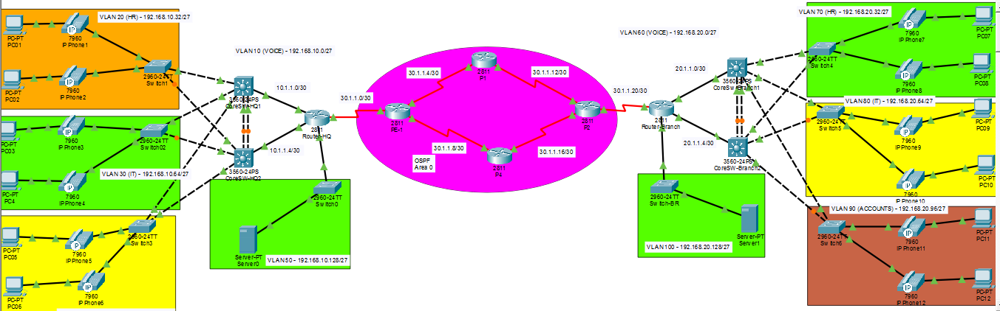

# Enterprise Multi-Site Network Architecture: Site-to-Site IPsec VPN, HSRP & CME VoIP

An enterprise dual-site network implementation simulated in Cisco Packet Tracer. The project connects a Headquarters (HQ) and Branch site across a simulated multi-router ISP backbone running OSPF Area 0, secured by an IPsec Site-to-Site VPN with NAT bypass, first-hop gateway redundancy (HSRP), multi-chassis link aggregation (PAgP EtherChannel), multi-VLAN segmentation, and inter-site VoIP via Cisco CallManager Express (CME).

---

## Network Architecture & Design



### Key Technologies Implemented
* **Layer 3 Site-to-Site IPsec VPN:** ISAKMP Phase 1 (AES-128, SHA-1, DH Group 5) and IPsec Phase 2 (ESP-AES, ESP-SHA-HMAC, Tunnel Mode).
* **PAT / NAT Exemption:** Bidirectional NAT overload for outside access paired with mirrored crypto-bypass access control lists.
* **First-Hop Redundancy Protocol (HSRP):** Active/Standby virtual gateways across dual Catalyst 3560 distribution multilayer switches per site.
* **Link Aggregation (PAgP EtherChannel):** Dual FastEthernet bundling between distribution switches in PAgP Desirable mode.
* **VLAN Segmentation & VTP:** Isolated functional zones (Voice, HR, IT, Accounts, Server) managed across VTP domains with dot1q trunking.
* **Dynamic Routing (ISP Core):** OSPF Area 0 multi-point backbone routing across provider edge and core routers.
* **VoIP Telephony (Cisco CME):** Auto-registering Cisco 7960 IP phones, DHCP Option 150 TFTP delivery, and inter-site dial-peers.

---

## IP Addressing & Subnet Architecture

### Local LAN Segmentation (FLSM /27)
* **HQ LAN (`192.168.10.0/24`):**
  * VLAN 10 (Voice): `192.168.10.0/27` | VIP: `192.168.10.1`
  * VLAN 20 (HR): `192.168.10.32/27` | VIP: `192.168.10.33`
  * VLAN 30 (IT): `192.168.10.64/27` | VIP: `192.168.10.65`
  * VLAN 40 (Accounts): `192.168.10.96/27` | VIP: `192.168.10.97`
  * Server Segment: `192.168.10.128/27` | Gateway: `192.168.10.129`

* **Branch LAN (`192.168.20.0/24`):**
  * VLAN 60 (Voice): `192.168.20.0/27` | VIP: `192.168.20.1`
  * VLAN 70 (HR): `192.168.20.32/27` | VIP: `192.168.20.33`
  * VLAN 80 (IT): `192.168.20.64/27` | VIP: `192.168.20.65`
  * VLAN 90 (Accounts): `192.168.20.96/27` | VIP: `192.168.20.97`
  * Server Segment: `192.168.20.128/27` | Gateway: `192.168.20.129`

### Routed Transit & ISP Serial Mesh (/30)
* **HQ Distribution Transit:** `10.1.1.0/30` (MLS1) and `10.1.1.4/30` (MLS2)
* **Branch Distribution Transit:** `20.1.1.0/30` (MLS1) and `20.1.1.4/30` (MLS2)
* **ISP Backbone Mesh:** `30.1.1.0/30`, `30.1.1.4/30`, `30.1.1.8/30`, `30.1.1.12/30`, `30.1.1.16/30`, `30.1.1.20/30`
* **VoIP CME Loopbacks:** HQ `10.10.10.10/32` | Branch `20.20.20.20/32`

---

## Verification & Operational Testing

1. **IPsec SA Validation:**
   ```text
   Router-HQ# show crypto isakmp sa
   ! Status: QM_IDLE / ACTIVE

   Router-HQ# show crypto ipsec sa
   ! Verified incrementing pkts encaps and pkts decaps with 0 errors
   ```

2. **HSRP Redundancy State:**
   ```text
   CoreSW-HQ1# show standby brief
   ! Confirmed Active state for Groups 1-4 pointing to VIPs .1, .33, .65, .97
   ```

3. **EtherChannel Status:**
   ```text
   CoreSW-HQ1# show etherchannel summary
   ! Group 1 (Po1) status: (SU) using protocol PAgP over Fa0/5(P) and Fa0/6(P)
   ```

4. **Inter-Site VoIP Calling:**
   Dialing extension `2010` on Branch `IP Phone 7` from HQ `IP Phone 1` (`1010`) routes voice RTP through dial-peer target `20.20.20.20` across the IPsec tunnel.